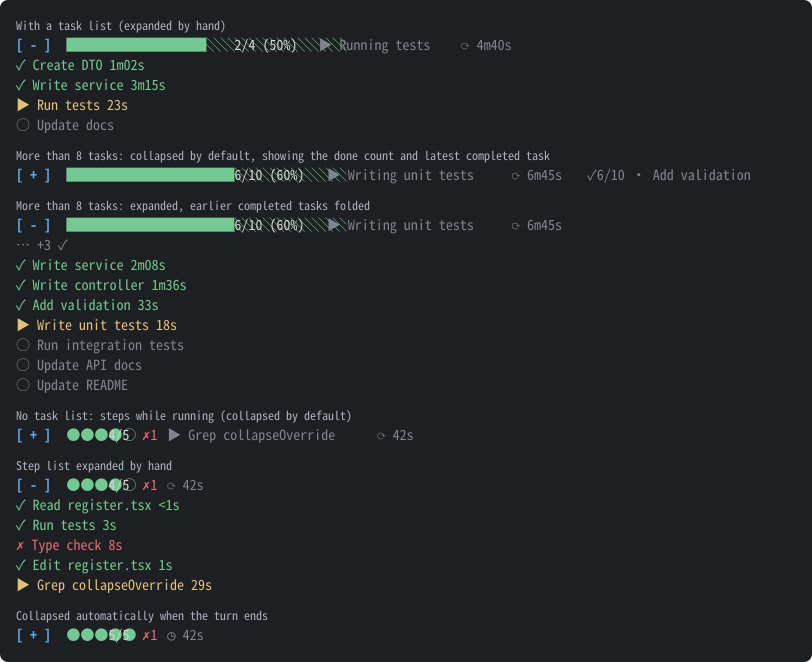

# task-progress

[繁體中文](README.md) | English

[](https://github.com/anguscyk/claude-mods-task-progress/releases/latest) [](LICENSE)

A Claude Code mod that shows a progress band above the prompt: a task progress bar with each task's duration, or the turn's tool calls as steps when there is no task list, plus the elapsed time of the current or last turn. The band uses language-neutral symbols, so it reads the same in any language.



> The preview is generated from what the mod actually draws (with simulated tasks and steps in the test environment); it is not a real terminal screenshot. Task and step names come from Claude, so they appear in whatever language the conversation uses.

With a task list:

```
[ - ] ██████████░░░░░░░░░░ 2/4 (50%)  ▶ Running tests  ⟳ 4m40s
  ✓ Create DTO     1m02s
  ✓ Write service  3m15s
  ▶ Run tests      12s
  ○ Update docs
```

With more than 8 tasks: when collapsed, the band shows the done count and the most recently completed task; when expanded, earlier completed tasks fold into "… +N ✓" and only the 3 most recent remain:

```
[ + ] ████████████░░░░░░░░ 6/10 (60%)  ▶ Writing unit tests  ⟳ 6m45s  ✓6/10 · Add validation
```

```
[ - ] ████████████░░░░░░░░ 6/10 (60%)  ▶ Writing unit tests  ⟳ 6m45s
  … +3 ✓
  ✓ Write service     2m08s
  ✓ Write controller  1m36s
  ✓ Add validation    33s
  ▶ Write unit tests  18s
  ○ Run integration tests
  ○ Update API docs
  ○ Update README
```

Without a task list, the turn's tool calls are shown as steps:

```
[ - ] ●●●●○ 4/5 ✗1  ⟳ 42s
  ✓ Read register.tsx  <1s
  ✓ Run tests          3s
  ✗ Type check         8s  Exit code 2 · error TS2322: Type 'string' is not assignable…
  ▶ Edit register.tsx  1s
```

Collapsed automatically when the turn ends:

```
[ + ] ●●●●● 5/5 ✗1  ◷ 1m10s
```

## Features

- **Step list**: without a task list, each tool call in the turn is a step (●○ dots plus "finished/total" such as 4/5 and the failure count ✗1; rows are marked ✓ succeeded / ✗ failed / ▶ running with their durations). Only the 5 most recent steps are listed; earlier ones fold into "… +N". When collapsed, the progress line shows the step that is running
- **Progress bar**: from Claude's task list (`TaskCreate` / `TaskUpdate` / `TodoWrite`), shows the done count, percentage and the task in progress
- **Task durations**: each task's time from in progress to completed; completed (✓), in progress (▶), not started (○)
- **Elapsed time**: on the same line as the progress; ⟳ updates every second while the turn runs, then ◷ shows the last turn's duration (main conversation only, subagents excluded)
- **Collapse / expand**: the `[ + ]` / `[ - ]` button at the start of the line (`[ + ]` collapsed, press to expand; `[ - ]` expanded, press to collapse). Always collapsed by default, even while running; expands only when you press it, and collapses again when the turn ends or you submit the next prompt
- **Collapsed summary**: shows "✓3/5 · Create DTO" (done count and the most recently completed task)
- **Folding**: with more tasks than the threshold, earlier completed tasks fold into "… +N ✓"
- **Name truncation**: names in the list and the collapsed summary are cut by display width (CJK characters take 2 columns, fitted to the terminal) and end with "…"; the running item on the progress line is shown in full
- **Aligned durations**: durations in the expanded list line up in one column, and anything under a second shows `<1s`; Bash steps show their description without the tool name
- **Error summary**: a failed ✗ step is followed by the refusal reason or the first line of the error (a bare Bash `Exit code N` is joined with the next line of output)

## How it works

task-progress only reads; it never changes what Claude does:

- `tool.call`: observes each tool call in the main conversation and records its name, duration and outcome (with an error summary). Every call passes through unchanged: its input is not modified, it is never blocked, and its result is not rewritten. `TaskCreate` / `TaskUpdate` / `TodoWrite` are also used to follow the task list
- `turn.start` / `turn.complete` / `prompt.submit`: time the turn, reset the steps and collapse the band each turn
- `ui.render` (`AbovePrompt`): draws the band above the prompt, keeping whatever other mods draw in the same place

All data stays in the local session state and is never sent anywhere.

## Install

At the Claude Code prompt in a terminal:

```
/plugin install task-progress --marketplace anguscyk/claude-mods-task-progress
```

Or from a shell:

```
claude plugin install task-progress --marketplace anguscyk/claude-mods-task-progress
```

When asked `Add marketplace?`, press `y`, then choose a scope (user by default).

The desktop app does not run `/plugin`: click + next to the prompt box, choose Plugins → Add marketplace, enter `anguscyk/claude-mods-task-progress`, then Add plugin.

## Settings

Adjust them in `/config` after installing, or set them under `pluginConfigs["task-progress"].options` in settings.json:

| Option | Description | Default | Range |
|--------|-------------|---------|-------|
| `nameMax` | Name width limit in the task/step list and the collapsed summary, in terminal columns (CJK characters take 2); longer names are cut and end with "…", and narrower terminals tighten it further so rows do not wrap (the running item on the progress line is always shown in full) | 80 | 1–200 |
| `foldThreshold` | Fold earlier completed tasks when there are more tasks than this | 8 | 1–200 |
| `keepDone` | Number of most recently completed tasks to keep when folding (0 folds them all) | 3 | 0–200 |

Invalid values fall back to the defaults; decimals are rounded down.

## Development

```
claude --plugin-dir .          # start a session with the mod loaded from this folder
claude plugin validate .       # check the manifest and hooks
claude plugin test .           # run tests/*.test.ts
scripts/gen-preview.sh         # regenerate docs/preview.svg and docs/preview.en.svg
```

After changing how the band looks, run `scripts/gen-preview.sh` to update the preview (requires `claude` and `python3`): the scenarios are in `scripts/preview/render-scenarios.ts` and the SVG conversion in `scripts/preview/tree2svg.py`.

Releases and the icon are produced with the maintainer's local tools, which are not under version control.

Project instructions for Claude Code are in `.claude/CLAUDE.md`.

## Changelog

Release notes for every version are on [GitHub Releases](https://github.com/anguscyk/claude-mods-task-progress/releases).

### [0.5.6](https://github.com/anguscyk/claude-mods-task-progress/releases/tag/v0.5.6) (2026-10-15)

- Development: moved `CLAUDE.md` to `.claude/CLAUDE.md`, which clears the `claude plugin validate` warning about a `CLAUDE.md` at the plugin root; Claude Code still loads it as project instructions in this repo
- Docs: the development section notes that the project instructions are in `.claude/CLAUDE.md`

### [0.5.5](https://github.com/anguscyk/claude-mods-task-progress/releases/tag/v0.5.5) (2026-10-15)

- Development: added `CLAUDE.md` describing the development commands, architecture, marketplace review constraints and release process, for Claude Code to reference when working in this repo

### [0.5.4](https://github.com/anguscyk/claude-mods-task-progress/releases/tag/v0.5.4) (2026-10-15)

- Docs: the development section notes that releases and the icon are produced with the maintainer's local tools, which are not under version control
- Development: the release and icon scripts are excluded with `.gitignore`; the README no longer names the icon file's path (the marketplace review treats an image path named in text as something that might be run)

### [0.5.3](https://github.com/anguscyk/claude-mods-task-progress/releases/tag/v0.5.3) (2026-10-15)

- Fixed: `formatDuration` no longer names a variable `h` (`h` is the JSX element factory, which the marketplace review requires to be used only as a call)
- Changed: removed `scripts/release.sh`. It read a GitHub credential, which put the marketplace review on hold; the release script now lives outside the repository
- Added: the marketplace icon
- Docs: the README gained a "How it works" section explaining that the hooks only observe — they never change or block tool calls — and that no data leaves the machine

### [0.5.2](https://github.com/anguscyk/claude-mods-task-progress/releases/tag/v0.5.2) (2026-10-15)

- Changed: `plugin.json` gained `homepage`, `repository` and `keywords`, and each `userConfig` option is marked `required: false`, matching the plugins in the community marketplace

### [0.5.1](https://github.com/anguscyk/claude-mods-task-progress/releases/tag/v0.5.1) (2026-10-15)

- Added: a failed ✗ step is followed by an error summary: the refusal reason, or the first line of the error (a bare Bash `Exit code N` is joined with the next line of output); the summary is dimmed and cut to the room left on the row
- Docs: the failed step in the preview and the README examples now shows a real error message

### [0.5.0](https://github.com/anguscyk/claude-mods-task-progress/releases/tag/v0.5.0) (2026-10-15)

- Changed: Bash steps show their description without the "Bash " prefix; Read, Edit and other tools keep their names (a file name alone does not say what was done)
- Changed: names are cut by terminal display width (CJK characters take 2 columns) and fitted to the terminal so rows do not wrap; `nameMax` now counts columns, and its default went from 40 to 80 (still about 40 CJK characters)
- Changed: durations in the expanded list line up in one column; anything under a second shows `<1s` instead of a column of `0s`
- Development: added `scripts/release.sh`, which sets the version, tags, creates a bilingual GitHub Release and links the README headings in one go
- Fixed: `scripts/release.sh` matches changelog headings only at the start of a line, so the same words in README body text are neither mistaken for a heading nor rewritten

### [0.4.2](https://github.com/anguscyk/claude-mods-task-progress/releases/tag/v0.4.2) (2026-10-15)

- Docs: added an English-task-name preview, `docs/preview.en.svg`; `scripts/gen-preview.sh` now generates both the Chinese and English previews
- Docs: added an English README (`README.en.md`), with the two READMEs linking to each other; removed the duplicated English introduction from the Chinese README

### [0.4.1](https://github.com/anguscyk/claude-mods-task-progress/releases/tag/v0.4.1) (2026-10-15)

- Docs: the preview (`docs/preview.svg`) adds two screens for more than 8 tasks: the collapsed "✓6/10 · most recently completed task", and the expanded view with earlier completed tasks folded into "… +3 ✓"
- Docs: the README examples add the same scenario as text

### [0.4.0](https://github.com/anguscyk/claude-mods-task-progress/releases/tag/v0.4.0) (2026-10-15)

- Changed: the collapsed summary "✓3/5，最近：X" became "✓3/5 · X", and the fold notice "…另有 N 項已完成" became "… +N ✓"; the band now uses language-neutral symbols throughout
- Removed: the `language` setting (added in 0.3.0). The band no longer has text to translate, so the setting had no effect; a stored `language` value is ignored

### [0.3.2](https://github.com/anguscyk/claude-mods-task-progress/releases/tag/v0.3.2) (2026-10-15)

- Changed: elapsed time uses language-neutral symbols: "執行中 42s" → "⟳ 42s", "上一輪耗時 42s" → "◷ 42s" (⏲ / ⏱ were not used: they are emoji, which some terminals draw as wide color glyphs that break the layout)
- Changed: the collapse / expand button became `[ + ]` / `[ - ]` at the start of the line, using the engine's button frame with plain ASCII instead of 0.3.1's ▸ / ▾; special symbols render as tiny fallback glyphs in some fonts and are hard to see

### [0.3.1](https://github.com/anguscyk/claude-mods-task-progress/releases/tag/v0.3.1) (2026-10-15)

- Changed: the collapse / expand button became a ▸ / ▾ icon at the start of the line (▸ collapsed, ▾ expanded) instead of a text button
- Changed: step counts became language-neutral: "5 步" → "4/5" (finished/total), the failure count "✗1" is always shown in red, and "…前面還有 N 步" → "… +N"
- Changed: the running item "進行中：X" → "▶ X" and the done count "已完成 3/5" → "✓3/5", so readers who do not read Chinese can follow without switching languages

### [0.3.0](https://github.com/anguscyk/claude-mods-task-progress/releases/tag/v0.3.0) (2026-10-15)

- Added: a `language` setting (`zh-TW` / `en`, default `zh-TW`) to switch the band's text to English; the English text handles singular and plural, and invalid values fall back to the default
- Changed: the band's text moved into a message table instead of being written into the drawing code

### [0.2.1](https://github.com/anguscyk/claude-mods-task-progress/releases/tag/v0.2.1) (2026-10-14)

- Changed: the descriptions in `plugin.json` and `marketplace.json`, and the titles and descriptions of the three `userConfig` options, are now in English for users of the community marketplace who do not read Chinese; the band's text stayed in Traditional Chinese
- Docs: the README gained an English introduction, latest-release and MIT license badges, and a preview (`docs/preview.svg`); the changelog links to GitHub Releases; the private-repository install note was removed once the repository went public
- Added: the MIT license (`LICENSE`)
- Development: added `scripts/gen-preview.sh` to regenerate the preview

### [0.2.0](https://github.com/anguscyk/claude-mods-task-progress/releases/tag/v0.2.0) (2026-10-14)

- Added: without a task list, the turn's tool calls in the main conversation are shown as steps (dots, ✓ / ✗ / ▶ and durations; only the 5 most recent are listed)
- Added: when the step list is collapsed, the progress line shows the step that is running
- Changed: the running / last-turn time moved onto the progress line
- Changed: always collapsed by default, even while running; expands only when you press the button, and collapses again when the turn ends or you submit the next prompt
- Changed: the `nameMax` default went from 20 to 40; the running item on the progress line is shown in full
- Fixed: the band did not keep what was drawn beneath it, which hid other mods' bands (such as next-steps)

### [0.1.0](https://github.com/anguscyk/claude-mods-task-progress/releases/tag/v0.1.0) (2026-10-14)

- Initial release: task progress bar, per-task durations, turn elapsed time, collapse / expand, folding of completed tasks, name truncation, and the `nameMax` / `foldThreshold` / `keepDone` settings

## License

This project is licensed under the [MIT License](LICENSE), Copyright (c) 2026 anguscyk.
