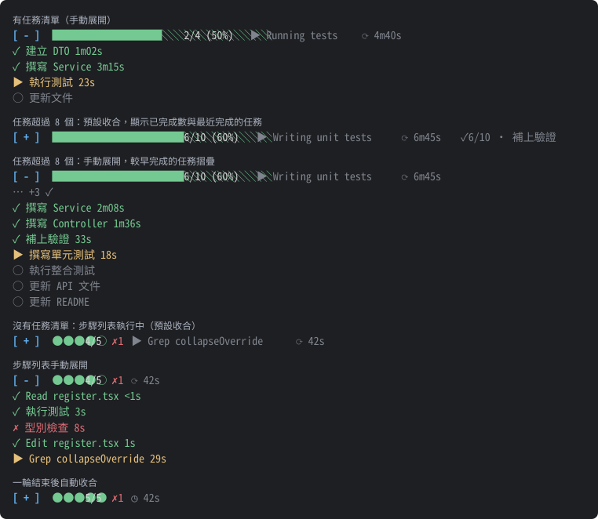

# task-progress

繁體中文 | [English](README.en.md)

[](https://github.com/anguscyk/claude-mods-task-progress/releases/latest) [](LICENSE)

Claude Code mod：在提示列上方顯示任務進度條、每個任務的耗時，以及本輪執行時間。



> 示意圖由 mod 實際繪出的內容產生（測試環境模擬的任務與步驟），非真實終端機截圖。

有任務清單時：

```
[ - ] ██████████░░░░░░░░░░ 2/4 (50%)  ▶ 執行測試  ⟳ 4m40s
  ✓ 建立 DTO      1m02s
  ✓ 撰寫 Service  3m15s
  ▶ 執行測試      12s
  ○ 更新文件
```

任務超過 8 個時：收合狀態顯示已完成數與最近完成的任務；展開後，較早完成的任務摺疊成「… +N ✓」，只留最近 3 筆：

```
[ + ] ████████████░░░░░░░░ 6/10 (60%)  ▶ Writing unit tests  ⟳ 6m45s  ✓6/10 · 補上驗證
```

```
[ - ] ████████████░░░░░░░░ 6/10 (60%)  ▶ Writing unit tests  ⟳ 6m45s
  … +3 ✓
  ✓ 撰寫 Service     2m08s
  ✓ 撰寫 Controller  1m36s
  ✓ 補上驗證         33s
  ▶ 撰寫單元測試     18s
  ○ 執行整合測試
  ○ 更新 API 文件
  ○ 更新 README
```

沒有任務清單時，以本輪的工具呼叫當作步驟：

```
[ - ] ●●●●○ 4/5 ✗1  ⟳ 42s
  ✓ Read register.tsx  <1s
  ✓ 執行測試           3s
  ✗ 型別檢查           8s  Exit code 2 · error TS2322: Type 'string' is not assignable…
  ▶ Edit register.tsx  1s
```

一輪結束後自動收合：

```
[ + ] ●●●●● 5/5 ✗1  ◷ 1m10s
```

## 功能

- **步驟列表**：沒有任務清單時，改以本輪每個工具呼叫當作一步（●○ 點狀進度與「已結束／總數」如 4/5、失敗數 ✗1，列表以 ✓ 成功／✗ 失敗／▶ 執行中標示並附耗時），只列最近 5 步，更早的摺疊為「… +N」；收合時進度列顯示目前執行中的步驟
- **進度條**：依 Claude 的任務清單（`TaskCreate` / `TaskUpdate` / `TodoWrite`）顯示完成數、百分比與目前進行中的任務
- **任務耗時**：每個任務從進行中到完成的時間；已完成打勾（✓）、進行中（▶）、未開始（○）
- **執行時間**：與進度列同一行，本輪進行中以 ⟳ 每秒更新，結束後以 ◷ 顯示上一輪耗時（只計主對話，不含子代理）
- **收合／展開**：行首的 `[ + ]`／`[ - ]` 按鈕（`[ + ]` 收合中，按下展開；`[ - ]` 展開中，按下收合）。一律預設收合（執行中也是），只有手動按下才展開；每輪結束或下一次送出提示時自動收回
- **收合摘要**：收合時顯示「✓3/5 · 建立 DTO」（已完成數與最近完成的任務）
- **摺疊**：任務數超過門檻時，較早完成的任務摺疊成「… +N ✓」
- **名稱截斷**：列表與收合摘要中的名稱依顯示寬度截斷並加「…」（中文字佔 2 格，並配合終端機寬度）；進度列的「進行中」顯示完整名稱
- **耗時對齊**：展開列表的耗時對齊成一欄，不到 1 秒顯示 `<1s`；Bash 步驟直接顯示說明，不加工具名稱
- **錯誤摘要**：失敗的 ✗ 步驟後面附上被拒絕的原因或錯誤訊息第一行（Bash 的 `Exit code N` 會接上下一行輸出）

## 安裝

在終端機的 Claude Code 提示列輸入：

```
/plugin install task-progress --marketplace anguscyk/claude-mods-task-progress
```

或在 shell 執行：

```
claude plugin install task-progress --marketplace anguscyk/claude-mods-task-progress
```

出現 `Add marketplace?` 時按 `y`，再選安裝範圍（預設 user）。

桌面版 App 不支援 `/plugin` 指令：點提示框旁的 +，選 Plugins → Add marketplace，填入 `anguscyk/claude-mods-task-progress`，再 Add plugin。

## 設定

安裝後可在 `/config` 調整，或寫在 settings.json 的 `pluginConfigs["task-progress"].options`：

| 選項 | 說明 | 預設 | 範圍 |
|------|------|------|------|
| `nameMax` | 任務／步驟列表與收合摘要的名稱寬度上限（以終端機格數計，中文字佔 2 格），超過截斷加「…」；終端機較窄時會再自動收窄，避免換行（進度列的「進行中」一律顯示完整名稱） | 80 | 1–200 |
| `foldThreshold` | 任務數超過此值時摺疊較早完成的任務 | 8 | 1–200 |
| `keepDone` | 摺疊時保留最近完成的筆數（0 表示全部摺疊） | 3 | 0–200 |

不合法的值會改用預設值，小數無條件捨去。

## 開發

```
claude --plugin-dir .          # 以本資料夾載入 mod 啟動 session
claude plugin validate .       # 檢查 manifest 與 hooks
claude plugin test .           # 執行 tests/*.test.ts
scripts/gen-preview.sh         # 重新產生 docs/preview.svg 與 docs/preview.en.svg 示意圖
scripts/release.sh X.Y.Z       # 發布新版本（加 --dry-run 先預覽步驟）
```

畫面改版後執行 `scripts/gen-preview.sh` 更新示意圖（需 `claude` 與 `python3`）：情境定義在 `scripts/preview/render-scenarios.ts`，SVG 轉換在 `scripts/preview/tree2svg.py`。

發布新版本：先在 `README.md` 與 `README.en.md` 的變更紀錄寫好該版本段落（標題分別為 `### X.Y.Z（YYYY-MM-DD）` 與 `### X.Y.Z (YYYY-MM-DD)`），再執行 `scripts/release.sh <版本>`。腳本會依序：

1. 檢查在 `main`、與 `origin/main` 同步、tag 尚不存在、兩份 README 都有該版本段落，且除了兩份 README 與 `plugin.json` 外沒有其他未提交的改動
2. 更新 `plugin.json` 版本，執行 `claude plugin validate` 與 `claude plugin test`，commit 並 push
3. 打 `v<版本>` tag 並 push
4. 建立 GitHub Release（中英並列，內容取自兩份 README 的該版本段落，並設為 Latest）
5. 把兩份 README 的版本標題補成 Release 連結，commit 並 push

GitHub 憑證優先使用環境變數 `GITHUB_TOKEN`，否則使用 git 已存的 github.com 憑證（如 macOS 鑰匙圈）；憑證不會輸出或寫入檔案。

## 變更紀錄

所有版本的發布說明見 [GitHub Releases](https://github.com/anguscyk/claude-mods-task-progress/releases)。

### [0.5.2](https://github.com/anguscyk/claude-mods-task-progress/releases/tag/v0.5.2)（2026-10-15）

- 變更：`plugin.json` 補上 `homepage`、`repository` 與 `keywords`，`userConfig` 各選項明確標示 `required: false`，欄位與社群 marketplace 的 plugin 一致

### [0.5.1](https://github.com/anguscyk/claude-mods-task-progress/releases/tag/v0.5.1)（2026-10-15）

- 新增：失敗的 ✗ 步驟後面附上錯誤摘要：被拒絕時顯示原因，錯誤時顯示訊息第一行（Bash 單獨的 `Exit code N` 會接上下一行輸出）；摘要以灰字顯示並依剩餘寬度截斷
- 文件：示意圖與 README 範例的失敗步驟改用實際的錯誤訊息

### [0.5.0](https://github.com/anguscyk/claude-mods-task-progress/releases/tag/v0.5.0)（2026-10-15）

- 變更：Bash 步驟直接顯示說明，不再加「Bash 」前綴；Read、Edit 等工具保留名稱（只看檔名分不出動作）
- 變更：名稱截斷改依終端機顯示寬度（中文字佔 2 格），並配合終端機寬度自動收窄、避免換行；`nameMax` 改以格數計，預設由 40 改為 80（中文仍約 40 字）
- 變更：展開列表的耗時對齊成一欄；不到 1 秒顯示 `<1s`，取代整排 `0s`
- 開發：新增 `scripts/release.sh`，一次完成改版本、打 tag、建立中英並列的 GitHub Release 與補 README 連結
- 修正：`scripts/release.sh` 只比對行首的變更紀錄標題，避免 README 內文出現同樣字樣時誤判或改壞內文

### [0.4.2](https://github.com/anguscyk/claude-mods-task-progress/releases/tag/v0.4.2)（2026-10-15）

- 文件：新增英文任務名稱的示意圖 `docs/preview.en.svg`；`scripts/gen-preview.sh` 一次產生中、英文兩張示意圖
- 文件：新增英文版 README（`README.en.md`），兩份 README 開頭互相連結；中文 README 移除重複的英文簡介

### [0.4.1](https://github.com/anguscyk/claude-mods-task-progress/releases/tag/v0.4.1)（2026-10-15）

- 文件：示意圖（`docs/preview.svg`）新增任務超過 8 個的兩個畫面：收合時的「✓6/10 · 最近完成的任務」，以及展開時較早完成的任務摺疊成「… +3 ✓」
- 文件：README 範例區塊加上同情境的文字範例

### [0.4.0](https://github.com/anguscyk/claude-mods-task-progress/releases/tag/v0.4.0)（2026-10-15）

- 變更：收合摘要「✓3/5，最近：X」→「✓3/5 · X」，摺疊提示「…另有 N 項已完成」→「… +N ✓」；畫面已全面使用不分語言的符號
- 移除：`language` 設定（0.3.0 加入）。畫面已無需翻譯的文字，此設定不再有作用；已存的 `language` 值會被忽略

### [0.3.2](https://github.com/anguscyk/claude-mods-task-progress/releases/tag/v0.3.2)（2026-10-15）

- 變更：執行時間改用不分語言的符號：「執行中 42s」→「⟳ 42s」、「上一輪耗時 42s」→「◷ 42s」（不採用 ⏲／⏱，因屬 emoji，部分終端機會以彩色寬字元顯示而跑版）
- 變更：收合／展開按鈕改為行首的 `[ + ]`／`[ - ]`：使用引擎的按鈕外框搭配純 ASCII，取代 0.3.1 的 ▸／▾；特殊符號在部分字型會以很小的替代字形顯示而不易辨識

### [0.3.1](https://github.com/anguscyk/claude-mods-task-progress/releases/tag/v0.3.1)（2026-10-15）

- 變更：收合／展開按鈕改為行首的 ▸／▾ 圖示（▸ 收合中、▾ 展開中），不再顯示文字按鈕
- 變更：步驟計數改為不分語言的寫法：「5 步」→「4/5」（已結束／總數）、失敗數「✗1」以紅色常駐顯示、「…前面還有 N 步」→「… +N」
- 變更：進行中項目「進行中：X」→「▶ X」，已完成數「已完成 3/5」→「✓3/5」，非中文使用者不需切換語言也能看懂

### [0.3.0](https://github.com/anguscyk/claude-mods-task-progress/releases/tag/v0.3.0)（2026-10-15）

- 新增：`language` 設定（`zh-TW` / `en`，預設 `zh-TW`），畫面文字可切換為英文；英文版處理單複數，設定不合法時回到預設
- 變更：畫面文字集中於訊息表，不再寫死於繪製程式

### [0.2.1](https://github.com/anguscyk/claude-mods-task-progress/releases/tag/v0.2.1)（2026-10-14）

- 變更：`plugin.json`、`marketplace.json` 的說明，以及 `userConfig` 三個選項的標題與說明改為英文，方便社群 marketplace 的非中文使用者；畫面文字維持繁體中文
- 文件：README 開頭加上英文簡介、最新版本與 MIT 授權徽章、畫面示意圖（`docs/preview.svg`）；變更紀錄加上 GitHub Releases 連結；repo 公開後移除私人 repo 安裝前提說明
- 新增：MIT 授權（`LICENSE`）
- 開發：新增 `scripts/gen-preview.sh` 重新產生示意圖

### [0.2.0](https://github.com/anguscyk/claude-mods-task-progress/releases/tag/v0.2.0)（2026-10-14）

- 新增：沒有任務清單時，以本輪主對話的工具呼叫當作步驟顯示（點狀進度、✓／✗／▶ 與耗時，只列最近 5 步）
- 新增：步驟列表收合時，進度列顯示目前執行中的步驟
- 變更：「執行中／上一輪耗時」改與進度列同一行
- 變更：一律預設收合（執行中也是），只有手動按「展開」才展開；每輪結束或下一次送出提示時收回
- 變更：`nameMax` 預設由 20 改為 40；進度列的「進行中」改為顯示完整名稱
- 修正：繪製時未保留下層內容，導致其他 mod（如 next-steps）的區塊被蓋掉

### [0.1.0](https://github.com/anguscyk/claude-mods-task-progress/releases/tag/v0.1.0)（2026-10-14）

- 初版：任務進度條、各任務耗時、本輪執行時間、收合／展開、摺疊已完成任務、名稱截斷，以及 `nameMax`／`foldThreshold`／`keepDone` 設定

## 授權

本專案採用 [MIT 授權](LICENSE)，Copyright (c) 2026 anguscyk。
